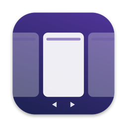

<p align="center">
  
</p>

<h1 align="center">Ruban</h1>

<p align="center">Un gestionnaire de fenêtres à défilement pour macOS, dans l'esprit de PaperWM et niri.</p>

<p align="center"><a href="README.md">English version</a></p>

---

Toutes les fenêtres sont posées côte à côte sur une bande horizontale sans fin. Rien ne se
chevauche, rien ne se cache derrière autre chose, et ouvrir une app de plus ne rétrécit jamais les
autres : la bande s'allonge, et tu la fais défiler au clavier ou en glissant trois doigts.

<p align="center">
  
</p>

> **État : bêta.** Ruban n'a été testé que sur une machine : macOS 27, Apple silicon, un seul écran
> intégré, clavier AZERTY. Plusieurs écrans, les Spaces et les trackpads externes sont gérés mais
> pas encore testés.

## Fonctions

- **La bande.** Une nouvelle fenêtre s'ouvre juste à droite de la fenêtre active. Changer de
  fenêtre fait défiler la bande juste assez pour la montrer, avec une animation qui part dès l'appui.
- **Glissé au trackpad.** Glisse trois doigts (ou quatre) : la bande suit tes doigts, puis glisse
  jusqu'à la colonne la plus proche en gardant leur élan. Un geste rapide file à la colonne suivante.
- **Largeurs.** Largeurs prédéfinies (33 / 50 / 66 % par défaut, réglables), pleine largeur,
  centrage, plus large ou plus étroite.
- **Glisser-déposer.** Attrape une fenêtre par sa barre de titre et lâche-la sur une autre pour
  l'empiler avec (au-dessus ou en dessous selon la moitié où tu la lâches), ou près du bord d'une
  fenêtre, ou entre deux, pour lui donner sa propre colonne. Un aperçu translucide montre où elle va
  atterrir avant que tu lâches. Ça marche aussi d'un écran à l'autre.
- **Piles et onglets.** Plusieurs fenêtres dans une colonne, hauteurs réglables, ou colonne en onglets.
- **Colonnes épinglées** au bord gauche ou droit pendant que le reste défile.
- **Indicateur de bande** givré : clique une tuile pour y aller, lâche-la sur une autre pour réunir
  les deux colonnes en une pile, ou entre deux tuiles pour déplacer la colonne.
- **Redimensionner à la souris** : la colonne prend la nouvelle largeur.
- **Une bande par écran et par Space**, et un raccourci pour envoyer une fenêtre à l'écran suivant.
- **Fenêtres flottantes.** Dialogues, Coup d'œil et fenêtres de taille fixe flottent seuls ; tu
  peux choisir des apps qui flottent toujours.
- **Bien élevé.** Les onglets natifs (Finder, Terminal) prennent une seule colonne, les apps qui
  imposent une taille minimale la gardent, une app en arrière-plan ne vole pas le focus, et l'ordre
  des colonnes revient après un redémarrage.
- **Natif et léger.** App Swift de barre des menus, réglages en SwiftUI appliqués instantanément.
  Une file en arrière-plan par app : une app occupée ne gèle jamais Ruban.
- **Automatisation.** Schéma d'URL `ruban://` et petit outil en ligne de commande `ruban`.

## Installer

Il faut macOS 14 ou plus récent sur Apple silicon, et Xcode (ou les Command Line Tools).

```bash
git clone https://github.com/niz-coder/ruban.git
cd ruban
./build.sh
```

`build.sh` compile, dessine l'icône, signe l'app et la copie dans `~/Applications/Ruban.app`. Avec
un certificat *Apple Development* ou *Developer ID*, l'autorisation Accessibilité survit aux
recompilations ; sans certificat, l'app est signée ad hoc et il faut la redonner après chaque build.

Au premier lancement, macOS demande l'autorisation **Accessibilité** : Réglages Système →
Confidentialité et sécurité → Accessibilité → active Ruban. Il démarre dès qu'elle est donnée.

### Libérer le glissé à trois doigts

Par défaut, macOS change de bureau avec un glissé horizontal à trois ou quatre doigts. Si macOS et
Ruban réagissent au même geste, macOS peut rester bloqué en plein changement de bureau : tant que
macOS utilise ce geste, Ruban le lui laisse, l'explique une fois, et le reprend dès qu'il est libre. Réglages Système → Trackpad → Plus de gestes →
*Balayer entre les apps en plein écran* : choisis **quatre doigts** (ou désactive-le), ou règle Ruban
sur quatre doigts. L'onglet *Mac Setup* de Ruban signale ce conflit et d'autres (Rectangle, Magnet,
AeroSpace, Stage Manager…).

## Raccourcis

Tous les raccourcis utilisent **⌃⌥** par défaut (⌃⌥⌘ au choix). Les lettres suivent la disposition
du clavier : sur AZERTY, ⌃⌥Q est la touche Q. Sur un clavier français, les deux touches de pile
sont `$` et `^`, à droite du P.

| Raccourci | Action |
|---|---|
| ⌃⌥ ← → (ou H L) | Colonne précédente / suivante |
| ⌃⌥⇧ ← → | Déplacer la colonne |
| ⌃⌥ ↑ ↓ (ou K J) | Monter / descendre dans une pile |
| ⌃⌥⌘ ← → | Première / dernière colonne |
| ⌃⌥ 1 … 9 | Aller à la colonne 1 à 9 |
| ⌃⌥ R / F / C | Largeur suivante / pleine largeur / centrer |
| ⌃⌥ = / - | Plus large / plus étroite |
| ⌃⌥ $ / ^ | Empiler dans la colonne de gauche / de droite |
| ⌃⌥⇧ $ / ^ | Sortir de la pile vers la droite / la gauche |
| ⌃⌥⇧ T | Colonne en onglets |
| ⌃⌥ T | Faire flotter / re-tuiler la fenêtre |
| ⌃⌥ P / ⌃⌥⇧ P | Épingler au bord gauche / droit |
| ⌃⌥ N | Envoyer à l'écran suivant |
| ⌃⌥ Q | Mettre Ruban en pause (toutes les fenêtres reviennent à l'écran) |

Le détail technique (API privées utilisées, architecture, développement) est dans le
[README anglais](README.md#how-it-works).

## Licence

[MIT](LICENSE)
